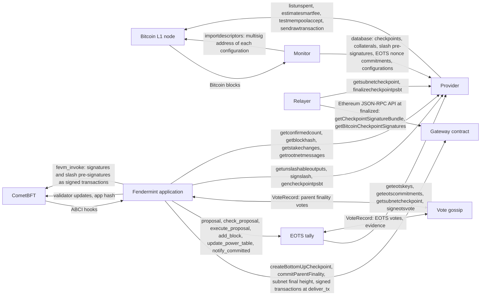
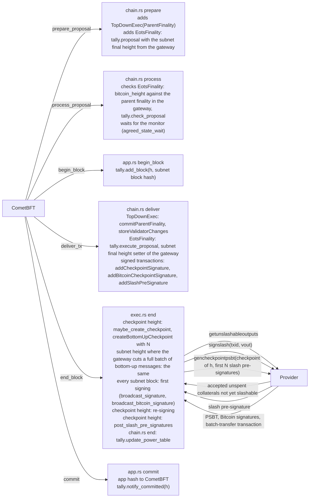
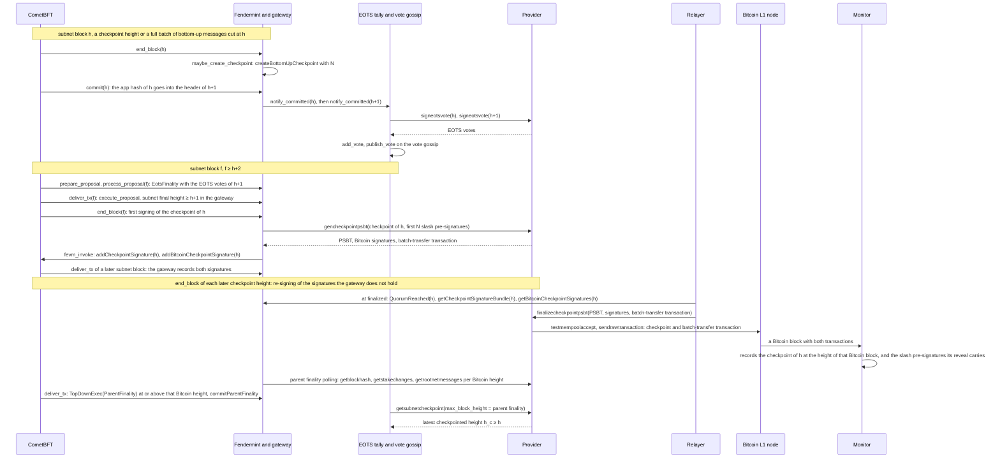

# Finality and checkpoints: module integration

## Scope

This document shows how the modules of a subnet with a Bitcoin parent work together to create and sign checkpoints, to record the subnet final height from EOTS votes, and to collect slash pre-signatures. It names the exact calls, messages and state between them. The rules are in the specification: [protocol consumers](../specs/slashing.md#protocol-consumers), [subnet final height](../specs/slashing.md#subnet-final-height), [casting an EOTS vote](../specs/slashing.md#casting-an-eots-vote), [extending the latest checkpointed block](../specs/slashing.md#extending-the-latest-checkpointed-block), [slash pre-signatures](../specs/slashing.md#slash-pre-signatures), [epoch 0](../specs/lifecycle.md#epoch-0), [checkpoints of epoch 0](../specs/transactions/checkpoint.md#checkpoints-of-epoch-0), [regular and rotation checkpoints](../specs/lifecycle.md#regular-and-rotation-checkpoints), [creating the transaction](../specs/transactions/checkpoint.md#creating-the-transaction), [verifying the transaction](../specs/transactions/checkpoint.md#verifying-the-transaction).

Notation and terms:

- `h` is a subnet height.
- Checkpoint height, checkpoint signature, Bitcoin signatures, first signing, re-signing: [protocol consumers](../specs/slashing.md#protocol-consumers). The gateway takes the checkpoint signature in `addCheckpointSignature` and the Bitcoin signatures in `addBitcoinCheckpointSignature`.
- `N`: [slash pre-signatures](../specs/slashing.md#slash-pre-signatures).

Code:

- `ipc/fendermint/`: `app/src/app.rs` (ABCI hooks), `vm/interpreter/src/chain.rs` (consensus messages), `vm/interpreter/src/fvm/exec.rs` and `fvm/checkpoint.rs` (end-block), `vm/topdown/src/eots.rs` (EOTS tally), `app/src/eots.rs` (`vote_loop`).
- `ipc/ipc/provider/src/checkpoint.rs`: relayer.
- `bitcoin-ipc/src/`: `provider/rpc.rs` (provider), `bin/monitor.rs` (monitor).

## 1. Modules

- CometBFT orders subnet blocks and calls the ABCI hooks of the Fendermint application (section 2).
- The gateway lives in the FVM state, under the app hash. Fendermint calls it directly in the hooks. Validators reach it through signed transactions that CometBFT puts in subnet blocks.
- The EOTS tally holds EOTS votes outside the app hash. `vote_loop` signs EOTS votes through the provider and publishes them on the vote gossip. Received EOTS votes go to `add_vote`.
- The provider signs with the validator key and answers from the monitor's database. The monitor builds that database from Bitcoin blocks alone.
- The relayer reads the subnet at the `finalized` tag and submits each checkpoint through its provider.

## 2. ABCI hooks

- Prepare and process read the parent finality and the subnet final height from the gateway, in the state of the previous subnet block.
- Process waits for the monitor (`agreed_state_wait`).
- Deliver of `EotsFinality` writes the subnet final height into the gateway ([subnet final height](../specs/slashing.md#subnet-final-height)).
- End-block creates the checkpoint at a checkpoint height and at a subnet height where the gateway cuts a full batch of bottom-up messages (`should_create_checkpoint`).
- End-block spawns tasks for the provider calls and the signed transactions. The hook never waits for them.
- The end-block of subnet block `h` returns its validator updates to CometBFT and to the EOTS tally, which apply them as [casting an EOTS vote](../specs/slashing.md#casting-an-eots-vote) states.

## 3. One checkpoint

- End-block runs the first signing and the re-signing of [protocol consumers](../specs/slashing.md#protocol-consumers) through `broadcast_signature` and `broadcast_bitcoin_signature`.
- The re-signing of checkpoint signatures reads the gateway's incomplete checkpoints (`getIncompleteCheckpoints`). The re-signing of Bitcoin signatures reads `h_c` from the EOTS tally and the Bitcoin signatures in the gateway.
- The relayer submits the checkpoint and its batch-transfer transaction through its provider. The monitor records the checkpoint from the Bitcoin block that includes it.
- Once the parent finality reaches the height of that Bitcoin block, the tally reads `h_c ≥ h` (`getsubnetcheckpoint`).
- Epoch 0 uses the same modules and calls. The provider builds its checkpoints on the regular path of `gencheckpointpsbt`. The monitor sets `H_0` at activation ([epoch 0](../specs/lifecycle.md#epoch-0)).

## 4. Interfaces

| Name | Caller | Callee | Inputs | Outputs | When |
|---|---|---|---|---|---|
| `TopDownExec(ParentFinality)` | proposer, `prepare` | every node, `process` and `deliver` | Bitcoin `height`, `block_hash` | parent finality (`commitParentFinality`), validator changes (`storeValidatorChanges`), top-down messages | the parent finality votes reach a quorum |
| `EotsFinality(EotsFinalityData)` | proposer, `prepare` | every node, `process` and `deliver` | `bitcoin_height` (the parent finality), `votes`, `evidence` | EOTS votes in the tally, subnet final height in the gateway | `tally.proposal` returns one |
| `tally.proposal`, `tally.check_proposal` | `prepare`, `process` | EOTS tally | `h_c` at `bitcoin_height` (`agreed_state`), subnet final height from the gateway | `EotsFinalityData`, or accept or reject | each proposal |
| `tally.execute_proposal` | `deliver` | EOTS tally | `EotsFinalityData` | EOTS votes and evidence stored | each `EotsFinality` |
| subnet final height setter | `deliver` of `EotsFinality` (system actor) | gateway | highest carried height | [subnet final height](../specs/slashing.md#subnet-final-height) | each `EotsFinality` |
| subnet final height getter | `prepare`, `process`, end-block, finality query, `finalized_height` | gateway | none | subnet final height | each read |
| `tally.add_block` | `begin_block` | EOTS tally | `h`, subnet block hash | none | each subnet block |
| `tally.update_power_table` | `chain.rs` `end` | EOTS tally | validator updates of subnet block `h` | power table per subnet height ([casting an EOTS vote](../specs/slashing.md#casting-an-eots-vote)), kept across a restart | end-block of subnet block `h`, when it returns validator updates |
| `tally.notify_committed` | `commit` | `vote_loop` | `h` | wakes `vote_loop` | each commit |
| `signeotsvote` | `vote_loop` | provider | `subnet_id`, `height`, `block_hash` | EOTS vote with its proof | each committed height the validator votes on |
| `geteotskeys`, `geteotscommitments` | `tally.refresh` | provider | `subnet_id`, `pk_eots` | EOTS keys, EOTS nonce commitments | each `vote_loop` round, each new parent finality |
| `getsubnetcheckpoint` | `tally.agreed_state`, relayer | provider | `subnet_id`, `max_block_height` | latest checkpoint recorded at or below that Bitcoin height | `prepare`, `process`, `deliver` of `EotsFinality`, each relayer round |
| `publish_vote` (`VoteRecord`) | `vote_loop` | vote gossip | EOTS vote or evidence | none | after signing, again every tenth round |
| `add_vote` | received EOTS votes (`cmd/run.rs`) | EOTS tally | EOTS vote | stored vote, or evidence | on receipt |
| `createBottomUpCheckpoint` | `maybe_create_checkpoint` | gateway | `BottomUpCheckpoint` of `h`, with `next_configuration_number` and `N` | checkpoint of `h` | end-block of a checkpoint height, or of a subnet height where the gateway cuts a full batch of bottom-up messages |
| `addCheckpointSignature` | `broadcast_signature` | gateway, through CometBFT | `h`, membership proof, weight, signature | signatory of `h`, `QuorumReached` | first signing, re-signing |
| `gencheckpointpsbt` | `broadcast_bitcoin_signature` | provider | checkpoint data of `h`, slash pre-signatures ([slash pre-signatures](../specs/slashing.md#slash-pre-signatures)) | PSBT, this validator's Bitcoin signatures, batch-transfer transaction | first signing, re-signing |
| `addBitcoinCheckpointSignature` | `broadcast_bitcoin_signature` | gateway, through CometBFT | `h`, PSBT, signatures, batch-transfer transaction | Bitcoin signatures of `h` | after `gencheckpointpsbt` |
| `getunslashableoutputs` | `post_slash_pre_signatures` | provider | `subnet_id` | accepted unspent collaterals not yet slashable, with keys and `signer` | posting ([slash pre-signatures](../specs/slashing.md#slash-pre-signatures)) |
| `signslash` | `post_slash_pre_signatures` | provider | `subnet_id`, `txid`, `vout` | `index`, `signature` | after `getunslashableoutputs` |
| `addSlashPreSignature` | `post_slash_pre_signatures` | gateway, through CometBFT | slash pre-signature | appended to the list | after `signslash` |
| `fevm_invoke` | `broadcast_signature`, `broadcast_bitcoin_signature`, `post_slash_pre_signatures` | CometBFT mempool | gateway calldata | transaction hash | each signature and slash pre-signature. Nonce from the pending state, a refused nonce retried (`broadcast.max_retries`) |
| `getconfirmedcount`, `getblockhash`, `getstakechanges`, `getrootnetmessages` | parent finality polling (`launch_polling_syncer`) | provider | Bitcoin height | Bitcoin block hash, validator changes, top-down messages | each polling round |
| `finalized` tag | relayer, consumers | Ethereum JSON-RPC API (`finalized_height`) | none | subnet final height from the gateway ([the Ethereum JSON-RPC API](../specs/slashing.md#the-ethereum-json-rpc-api)) | each read |
| `getCheckpointSignatureBundle`, `getBitcoinCheckpointSignatures` | relayer (`checkpoint_bundle_at`) | gateway, at `finalized` | `h` | checkpoint, checkpoint signatures, PSBT, Bitcoin signatures, batch-transfer transaction | after `QuorumReached` for `h` |
| `finalizecheckpointpsbt` | relayer (`submit_checkpoint`) | provider | PSBT, signatures, batch-transfer transaction | `txid`, `batch_transfer_txid` | once per checkpoint |
| `testmempoolaccept`, `sendrawtransaction` | provider (`submit_to_mempool`) | Bitcoin L1 node | checkpoint, batch-transfer transaction | none | in `finalizecheckpointpsbt` |
| `listunspent`, `estimatesmartfee` | provider (`plan_checkpoint`) | Bitcoin L1 node, watch-only wallet | multisig address of the checkpoint's configuration | fund UTXOs, fee rate | in `gencheckpointpsbt` |
| Bitcoin blocks | monitor (`Monitor::sync`, `process_block`) | Bitcoin L1 node | Bitcoin height | Bitcoin block | each new Bitcoin block |

## 5. State

| Value | Where | Written by | Read by |
|---|---|---|---|
| checkpoint of `h` (`BottomUpCheckpoint`) with `N` | gateway, under the app hash | end-block `h` (`createBottomUpCheckpoint`) | end-block, relayer |
| checkpoint signatures of `h` and their quorum | gateway, under the app hash | `addCheckpointSignature` | end-block re-signing (`getIncompleteCheckpoints`, `checkpoint_signatories`), relayer |
| Bitcoin signatures of `h`, with the PSBT and the batch-transfer transaction | gateway, under the app hash | `addBitcoinCheckpointSignature` | end-block re-signing, relayer |
| slash pre-signatures, in posting order | gateway, under the app hash | `addSlashPreSignature` | end-block: `N` at creation, `post_slash_pre_signatures`, `gencheckpointpsbt` |
| subnet final height | gateway, under the app hash | deliver of `EotsFinality` | `prepare`, `process`, end-block, EOTS tally, finality query, `finalized` tag |
| parent finality | gateway, under the app hash | deliver of `TopDownExec` (`commitParentFinality`) | `prepare`, `process`, end-block |
| power table and validator changes | gateway, under the app hash | deliver of `TopDownExec` (`storeValidatorChanges`), end-block (`apply_validator_changes`) | `maybe_create_checkpoint` |
| EOTS votes, evidence | EOTS tally | `add_vote`, `execute_proposal` | `proposal`, `check_proposal`, `vote_loop` |
| subnet block hashes | EOTS tally | `add_block` | `check_proposal`, `vote_loop` |
| power table per subnet height, with the pending validator update | EOTS tally | `update_power_table` | `add_vote`, `check_proposal` |
| EOTS keys, EOTS nonce commitments | EOTS tally, in memory | `refresh` | `add_vote`, `check_proposal` |
| `h_c` at the parent finality of the last `EotsFinality` | EOTS tally | `execute_proposal` | `add_vote`, `vote_loop`, end-block re-signing of Bitcoin signatures |
| recorded checkpoints (`SubnetCheckpoint`) | monitor | `process_block`, on a checkpoint and its batch-transfer transaction | provider: `getsubnetcheckpoint`, `gencheckpointpsbt` |
| collaterals (`UeCollateral`), spent or not | monitor | `process_block`, on join and stake transactions and spends | provider: `getunslashableoutputs`, `geteotskeys` |
| slash pre-signatures carried to Bitcoin L1 | monitor | `process_block`, on a batch-transfer transaction | provider: `getunslashableoutputs`. Monitor: configurations at each cutoff |
| EOTS nonce commitments | monitor | `process_block`, on join transactions | provider: `geteotscommitments`, `signeotsvote` |
| `H_0` | monitor | `process_block`, at activation | monitor: epochs and cutoff heights |
| epoch, configurations | monitor | `process_block`, at each cutoff | provider: `gencheckpointpsbt` |
| fund UTXOs | Bitcoin L1 node, watch-only wallet | Bitcoin blocks, for the multisig addresses the monitor imports | provider: `plan_checkpoint` |
    