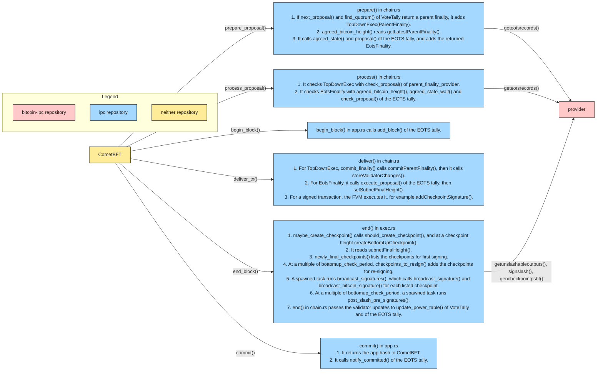
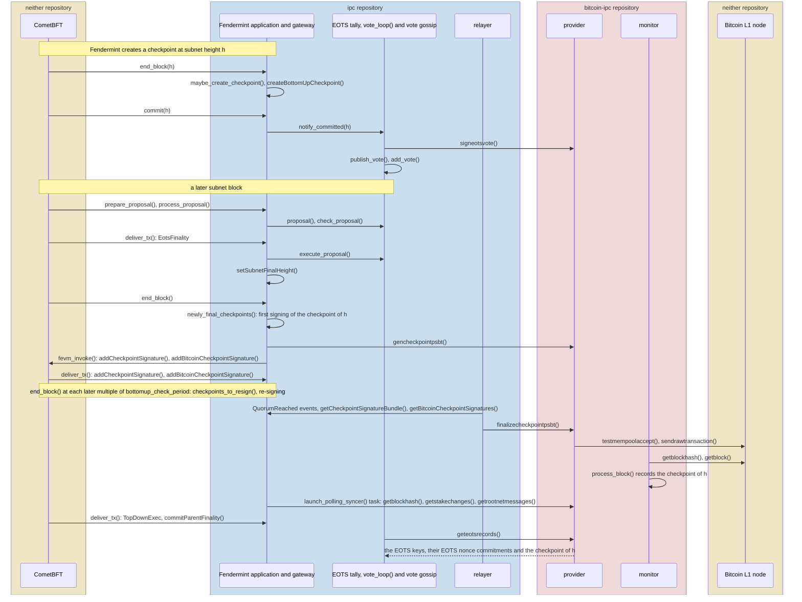

# Finality and checkpoints: module integration

## Scope

This document shows how the modules of a subnet with a Bitcoin parent work together to create and sign checkpoints, to record the subnet final height from EOTS votes, and to collect slash pre-signatures. It names the calls between the modules, so that a reviewer can check in which module each step runs. The rules are in the specification: [protocol consumers](../specs/slashing.md#protocol-consumers), [subnet final height](../specs/slashing.md#subnet-final-height), [casting an EOTS vote](../specs/slashing.md#casting-an-eots-vote), [extending the latest checkpointed block](../specs/slashing.md#extending-the-latest-checkpointed-block), [slash pre-signatures](../specs/slashing.md#slash-pre-signatures), [epoch 0](../specs/lifecycle.md#epoch-0), [checkpoints of epoch 0](../specs/transactions/checkpoint.md#checkpoints-of-epoch-0), [regular and rotation checkpoints](../specs/lifecycle.md#regular-and-rotation-checkpoints), [creating the transaction](../specs/transactions/checkpoint.md#creating-the-transaction), [verifying the transaction](../specs/transactions/checkpoint.md#verifying-the-transaction).

`h` is a subnet height. Checkpoint height, checkpoint signature, Bitcoin signatures, first signing and re-signing are defined in [protocol consumers](../specs/slashing.md#protocol-consumers).

Code:

- `ipc/fendermint/`: `app/src/app.rs` (ABCI hooks), `vm/interpreter/src/chain.rs` (consensus messages), `vm/interpreter/src/fvm/exec.rs` and `fvm/checkpoint.rs` (end-block), `vm/interpreter/src/fvm/state/ipc.rs` (`GatewayCaller`), `vm/topdown/src/eots.rs` (`EotsTally`), `vm/topdown/src/voting.rs` (`VoteTally`), `app/src/eots.rs` (`vote_loop()`), `app/src/cmd/run.rs` (`dispatch_vote()`).
- `ipc/ipld/resolver/`: the resolver `Service`, which carries the vote gossip.
- `ipc/contracts/contracts/gateway/`: the gateway functions.
- `ipc/ipc/provider/src/checkpoint.rs` (relayer), `ipc/ipc/provider/src/manager/btc/manager.rs` (`BtcSubnetManager`, the client of the provider).
- `bitcoin-ipc/src/`: `provider/rpc.rs` (provider), `bin/monitor.rs` (monitor), `db.rs` (database).

## 1. Modules

```mermaid
%%{init: {"flowchart": {"wrappingWidth": 420}}}%%
flowchart LR
  BTC["Bitcoin L1 node (Bitcoin Core)"]
  MON["monitor"]
  DB[("database of the monitor (db.rs)")]
  PRV["provider"]
  CMT["CometBFT"]
  subgraph FMT ["Fendermint (fendermint run)"]
    APP["Fendermint application: the ABCI hooks"]
    TAL["EOTS tally: EotsTally, a struct that holds the EOTS votes, the evidence, the subnet block hashes and the power tables"]
    VL["vote_loop(): signs and publishes the EOTS votes of the validator"]
    GOS["vote gossip: the Gossipsub topic /ipc/ipld/votes of the resolver Service (ipld/resolver)"]
  end
  GW["gateway (GatewayDiamond)"]
  REL["relayer (ipc-cli checkpoint relayer)"]

  MON -->|"getblockhash(), getblock(), importdescriptors()"| BTC
  MON -->|"process_block() writes"| DB
  PRV -->|"reads"| DB
  CMT -->|"prepare_proposal(), process_proposal(), begin_block(),<br/>deliver_tx(), end_block(), commit()"| APP
  APP -->|"fevm_invoke() submits signed transactions"| CMT
  APP -->|"createBottomUpCheckpoint(), commitParentFinality(), storeValidatorChanges(),<br/>getLatestParentFinality(), setSubnetFinalHeight(), subnetFinalHeight(),<br/>addCheckpointSignature(), addBitcoinCheckpointSignature(), addSlashPreSignature()"| GW
  APP -->|"agreed_state(), proposal(), agreed_state_wait(), check_proposal(),<br/>execute_proposal(), add_block(), update_power_table(), notify_committed()"| TAL
  APP -->|"getunslashableoutputs(), signslash(), gencheckpointpsbt(),<br/>getconfirmedcount(), getblockhash(), getstakechanges(), getrootnetmessages()"| PRV
  APP -->|"publish_vote_loop()"| GOS
  GOS -->|"dispatch_vote() calls add_vote() of VoteTally"| APP
  GOS -->|"dispatch_vote() calls add_vote()"| TAL
  VL -->|"refresh(), votes_to_cast(), mark_cast()"| TAL
  VL -->|"signeotsvote()"| PRV
  VL -->|"publish_vote()"| GOS
  TAL -->|"geteotsrecords()"| PRV
  PRV -->|"listunspent(), estimatesmartfee(), testmempoolaccept(), sendrawtransaction()"| BTC
  REL -->|"QuorumReached events, getCheckpointSignatureBundle(), getBitcoinCheckpointSignatures()"| GW
  REL -->|"getsubnetcheckpoint(), finalizecheckpointpsbt()"| PRV

  subgraph Legend
    LB["bitcoin-ipc repository"]
    LI["ipc repository"]
    LX["neither repository"]
  end

  classDef bitcoinipc fill:#ffc9c9,stroke:#1e1e1e,color:#1e1e1e
  classDef ipc fill:#a5d8ff,stroke:#1e1e1e,color:#1e1e1e
  classDef external fill:#ffec99,stroke:#1e1e1e,color:#1e1e1e
  class MON,DB,PRV,LB bitcoinipc
  class APP,TAL,VL,GOS,GW,REL,LI ipc
  class BTC,CMT,LX external
```

- An arrow goes from the caller to the callee. Its label lists the calls.
- CometBFT calls the ABCI hooks of the Fendermint application (section 2).
- The Fendermint application calls the gateway through `GatewayCaller`, one method per gateway function: `create_bottom_up_checkpoint()` calls `createBottomUpCheckpoint()`.
- `fevm_invoke()` submits `addCheckpointSignature()`, `addBitcoinCheckpointSignature()` and `addSlashPreSignature()` as signed transactions to CometBFT (`broadcast_tx_sync()`). `deliver_tx()` of a later subnet block executes them in the gateway.
- The EOTS tally and the vote gossip are not modules. Both run in the Fendermint process: `run.rs` starts the resolver `Service`, spawns `vote_loop()` and `publish_vote_loop()`, and passes each received `AppVote` to `dispatch_vote()`.
- The provider signs with the validator key and the EOTS key, and reads the database of its monitor. The monitor builds that database from Bitcoin blocks alone.
- The relayer (`BottomUpCheckpointManager`) reads the gateway through the Ethereum JSON-RPC API, up to the `finalized` tag (`finalized_epoch()`).

## 2. ABCI hooks

- The ABCI hooks in `app.rs` call `prepare()`, `process()`, `deliver()` and `end()` of `chain.rs`. `end()` of `chain.rs` calls `end()` of `exec.rs` first.
- `agreed_state()` calls `geteotsrecords()` once: the answer holds the EOTS keys, their EOTS nonce commitments and the latest checkpoint at one Bitcoin height. `agreed_state_wait()` calls `agreed_state()` again until the provider answers, so `process()` waits for the monitor.
- `end()` of `exec.rs` does not wait for the spawned tasks. They submit their gateway calls through `fevm_invoke()`.

## 3. One checkpoint

`should_create_checkpoint()` also creates a checkpoint at a subnet height that is not a multiple of `bottomup_check_period`: a height where `commitBottomUpMsg()` of the gateway cut a full `BottomUpMsgBatch` (`maxMsgsPerBottomUpBatch` messages).

- First signing and re-signing ([protocol consumers](../specs/slashing.md#protocol-consumers)) both run in `end()` of `exec.rs`, through `broadcast_signatures()`.
- `checkpoints_to_resign()` reads `getIncompleteCheckpoints()`, `getCheckpointSignatureBundle()` (`checkpoint_signatories()`) and `hasBitcoinCheckpointSignature()` of the gateway, and `agreed_checkpointed_height()` of the EOTS tally.
- `broadcast_bitcoin_signature()` passes the slash pre-signatures of `getSlashPreSignatures()` to `gencheckpointpsbt()`. `post_slash_pre_signatures()` calls `getunslashableoutputs()` and `signslash()`, then submits `addSlashPreSignature()` through `fevm_invoke()`.
- The relayer (`submit_next_epoch()`) reads the gateway up to `finalized_epoch()`. `submit_checkpoint()` calls `finalizecheckpointpsbt()`, and the provider sends the checkpoint and its batch-transfer transaction through `submit_to_mempool()`.
- `agreed_state()` of the EOTS tally calls `geteotsrecords()` with the parent finality as `max_block_height`.
- The EOTS tally deletes the EOTS votes, the subnet block hashes and the superseded power tables at or below the subnet final height. The finality query answers the subnet final height and the conflict height only. The provider deletes its EOTS signer records at or below the latest checkpointed height in `signeotsvote()`.
- `vote_loop()` publishes each EOTS vote once, records the greatest subnet height it voted at, and continues from there after a restart. Evidence of double votes is not published on the vote gossip. The EOTS tally keeps at most two EOTS votes per EOTS key and height, and a proposal carries at most one evidence per EOTS key; a proposal with more is invalid.
- Epoch 0 uses the same modules and calls ([epoch 0](../specs/lifecycle.md#epoch-0)).
