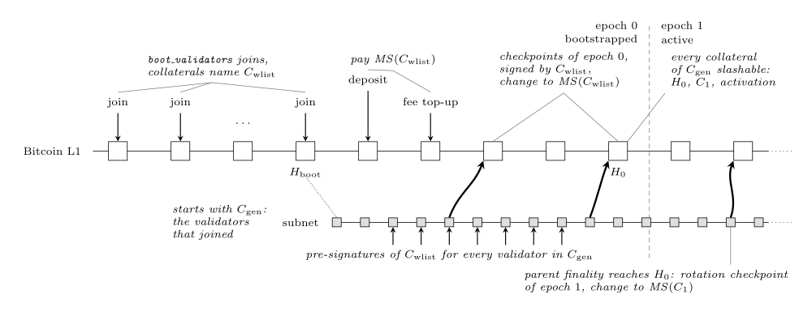

# Subnet lifecycle

This document follows a subnet from creation to end: who submits which transaction and when, how the monitor derives the configurations and status from Bitcoin L1, the state it keeps and how it processes blocks. The last section gives the conditions on the parameter values. Slashing, from the votes on the subnet to the slash transaction, is in [slashing.md](slashing.md). The transaction formats and the monitor's checks on each are in `transactions/`, the encodings and scripts in [encoding.md](encoding.md).

## Actors

- The **creator** chooses the subnet's parameters and submits the create transaction.
- A **validator** holds a validator key, an x-only key with even Y. It joins with a collateral, runs a subnet node, signs checkpoints and slash transactions with its key, submits checkpoints to Bitcoin L1, and exits after its collateral matures. It acts on Bitcoin L1 through its provider.
- A **user** deposits BTC into a subnet, transfers within and between subnets, and withdraws to Bitcoin L1.
- The **subnet** is the validators of its current configuration running the subnet's consensus. It produces subnet blocks, decides the content of each checkpoint and collects the validators' signatures.
- A **provider** serves one validator or user. It builds, signs and submits their Bitcoin L1 transactions with its Bitcoin L1 wallet and, for a validator, the validator key. It answers queries from the state of its monitor.
- A **monitor** reads final Bitcoin L1 blocks and derives the state of every subnet from them alone. All honest monitors hold the same state.

The programs that implement these roles, what each holds, whom it calls and what it trusts are in [modules.md](modules.md).

## Parameters

### Network parameters

A Bitcoin L1 block is final once at least `CONFIRMATIONS` blocks are on top of it. A deployment sets `CONFIRMATIONS` once, for all its monitors.

The prefix of every subnet id names the Bitcoin L1 network:

| Network | Prefix |
|---|---|
| mainnet | `/b1` |
| testnet3 | `/b2` |
| testnet4 | `/b22` |
| signet | `/b3` |
| regtest | `/b4` |

### Protocol constants

| Name | Value | Meaning |
|---|---|---|
| `MIN_CONFIGURATION_SIZE` | 4 | the number of validators below which a configuration may not be able to make progress |
| `MAX_TOTAL_POWER` | 2³¹ − 1 | the maximum total power of a configuration |

### Subnet parameters

The creator sets every subnet parameter in the [create transaction](transactions/create-subnet.md). No parameter changes afterwards.

| Name | Meaning |
|---|---|
| `min_validator_stake` | the minimum collateral of a join transaction, in satoshis |
| `power_unit` | the number of satoshis per unit of power, `10^p` for an integer `p` with `0 ≤ p ≤ 15` |
| `boot_validators` | the number of accepted join transactions that bootstraps the subnet (the code calls it `min_validators`). It also sets the threshold of `C_wlist` |
| `bottomup_check_period` | the number of subnet blocks between two checkpoints |
| `active_validators_limit` | the maximum number of validators of a configuration |
| `min_cross_msg_fee` | the minimum fee of a cross-subnet message, in satoshis |
| `whitelist` | the x-only keys that may join before activation |
| `K` | the length of an epoch, in Bitcoin L1 blocks |
| `min_timeout`, `max_timeout` | the minimum and maximum number of epochs for which a collateral seats its owner |
| `min_deposit` | the minimum value of a deposit or fee top-up transaction that the monitor credits, in satoshis (fee top-up transaction **unimplemented**) |
| `kill_vote_period` | the number of subnet blocks for which a kill proposal stays open |
| `kill_delay_period` | the number of epochs for which a subnet marked to be killed stays fully operational before its kill checkpoint |

[Instantiating the parameters](#instantiating-the-parameters), at the end of this document, gives the conditions on their values.

## Power and thresholds

A validator whose seating collaterals hold `S` satoshis in total has power `⌊S / power_unit⌋`. This formula assigns the power on Bitcoin L1 (configuration multisigs) and on the subnet (the validator set). Every accepted collateral has power at least 1, because its value is at least `min_validator_stake`, which is at least `power_unit`. The monitor rejects a join or stake transaction that would bring the total power of the active validators above `MAX_TOTAL_POWER`, so no configuration exceeds it. The subnet keeps each validator's total value and gives it the power `⌊total / power_unit⌋`.

A configuration of total power `P` has threshold `⌊2P / 3⌋ + 1`, except `C_wlist`, whose threshold is `⌊2 · boot_validators / 3⌋ + 1`.

## Configurations

A configuration (called `SubnetCommittee` in the code) is a set of validators, each with a key and a power, with its own multisig address on Bitcoin L1. A subnet's configurations are `C_wlist` (the whitelist configuration), `C_gen` (the genesis configuration), then `C_1`, `C_2`, …, where `C_e` is the configuration of epoch `e`. In epoch 0, `C_gen` runs the subnet and `C_wlist` holds the funds and signs the checkpoints, so `C_wlist` is the previous configuration of epoch 1. The rest of this document provides more information on how they are computed.

## Lifecycle

### Creating the subnet

The creator submits the [create transaction](transactions/create-subnet.md). The monitor checks the [validity of the parameters](#validity-of-the-parameters), derives the subnet id (`SubnetId` in the code, built with `SubnetId::from_txid`) from the txid of the reveal transaction and stores the subnet's genesis info. The 20-byte form of the subnet id is `txid20` ([subnet id](encoding.md#subnet-id)). The subnet is now *created*.

### Configuration C_wlist

The initial configuration `C_wlist` for a subnet is specified in the create transaction of that subnet: it consists the keys in the `whitelist` argument, each with power 1, and threshold `⌊2 · boot_validators / 3⌋ + 1`.
Any validator in `whitelist` can contribute to that threshold in order to spend `MS(C_wlist)`, regardless of whether it submitted a join transaction or not.

The purpose of configuration `C_wlist`, along with epoch `0`, is to collect the required slash pre-signatures and bootstrap the subnet, as explained below. This requires a running subnet, as signatures are collected on L2 subnets, and a concrete configuration must be named in the scripts of these transactions.

### Joins and prefunds before bootstrap

From creation until bootstrap, every validator with a whitelisted key may submit a [join transaction](transactions/join.md), whose collateral names `C_wlist`. Validators may also submit [prefund transactions](transactions/prefund.md), which pay `MS(C_wlist)` and give an EVM address a genesis balance on the subnet. Every member of `C_wlist` has a subnet account from genesis.
The monitor checks each join transaction as [join](transactions/join.md#verifying-the-transaction) describes and adds each accepted prefund transaction to the genesis balances. It accepts prefund transactions only before bootstrap.

### Computing configuration C_gen

The subnet bootstraps at the accepted join transaction that brings the number of accepted join transactions to `boot_validators`. `H_boot` is the height of the Bitcoin block that contains it. When it processes that join transaction, the monitor computes `C_gen`, the genesis configuration: the validators of the first `boot_validators` accepted join transactions, each with power 1. In other words, `C_gen` is a subset of `C_wlist` with size `boot_validators`. The subnet is now *bootstrapped* and starts producing subnet blocks. Epoch 0 begins.

### Epoch 0

From `H_boot` on, the subnet produces subnet blocks with `C_gen` as its validator set. Epoch 0 exists only to prepare activation:

1. For every member of `C_gen`, the validators of `C_wlist` sign the slash transaction of the member's collateral. The subnet collects these slash pre-signatures ([slashing](slashing.md#before-bootstrap-and-in-epoch-0)).
2. The monitor accepts no join transaction. Users may submit deposit transactions and validators fee top-up transactions (fee top-up **unimplemented**). Both pay `MS(C_wlist)`, and each is a fund UTXO of `C_wlist`. The subnet credits a deposit transaction once its parent finality reaches the Bitcoin block that includes it, in epoch 0 as after activation ([deposit](transactions/deposit.md#verifying-the-transaction)). Validators pay no fee for their checkpoint signatures, Bitcoin signatures and slash pre-signatures in epoch 0. A validator's subnet account must still hold a balance to submit them. A deposit transaction to its address provides that balance once the subnet credits it.
3. The subnet creates [checkpoints](#checkpoints) as after activation. They are regular checkpoints of `C_wlist` ([checkpoints of epoch 0](transactions/checkpoint.md#checkpoints-of-epoch-0)). Their batch-transfer transactions carry the slash pre-signatures of the collaterals accepted before activation, among them the join collaterals of `C_gen`.
4. The first *cutoff height* `H_0` is the first Bitcoin L1 height at which the join collateral of every member of `C_gen` is spent or [slashable](slashing.md#slashable-outputs). After the transactions of the Bitcoin block at that height, the monitor sets `H_0`, computes `C_1` ([C_1](#computing-configuration-c_1)) and activates the subnet ([activation](#activation)). Epochs count from `H_0`.

*Bootstrap of a subnet, from the joins to activation: Bitcoin L1 blocks on top, subnet blocks below.*

### Activation

Activation ends epoch 0. It happens when the monitor sets `H_0`, after the transactions of the Bitcoin block at `H_0`. The subnet becomes *active*, and epoch 1 begins ([epochs](#epochs)). The [subnet status](#subnet-status) table lists every status.

### Computing configuration C_1

The monitor computes `C_1` at `H_0` as at any cutoff ([C_e](#computing-configuration-c_e-for-e--2)). It holds the members of `C_gen` that satisfy both conditions:

1. The collateral of the member's join transaction is unspent at `H_0` and [slashable](slashing.md#slashable-outputs).
2. The collateral's timeout `T` satisfies `T > H_0 + 3K`.

Each member of `C_1` has the power of the total value of its join collateral and of every collateral of its stake transactions of epoch 0 that is unspent and slashable at `H_0` with `T > H_0 + 3K`, as at any cutoff. `C_1` may be smaller than `C_gen` and than `boot_validators`. If no member of `C_gen` qualifies, `C_1` is `C_gen`. If `C_1` has fewer than `MIN_CONFIGURATION_SIZE` members, the subnet may not be able to make progress.

### After activation

From activation until the subnet is killed, the following operations are active (details in the following paragraphs):

- New validators submit [join transactions](transactions/join.md) whose collaterals name the current or the previous (at the time of creation of the join transaction) configuration. An accepted join transaction becomes effective (gives a seat to its validator) in the configurations computed at the next cutoffs. A validator that has already joined can add collateral, or renew a matured one, with a [stake transaction](transactions/stake.md) (stake transaction **unimplemented**).
- A collateral stops seating its owner before it matures ([maturity of a collateral](#maturity-of-a-collateral)). From Bitcoin block `T + 1` on, the owner spends it with the [exit transaction](transactions/exit.md), which pays it through the unilateral-exit leaf to the owner's backup address, without the subnet's validators. The owner may leave earlier with a cooperative exit.
- Users submit [deposit transactions](transactions/deposit.md) to the current configuration's multisig. Validators supply the fee reserve with fee top-up transactions (fee reserve and fee top-up transactions **unimplemented**). A deposit transaction, fee top-up transaction or incoming transfer to the previous configuration's multisig still counts if included in a Bitcoin block at most `K/2` blocks after the cutoff that ends that configuration's epoch ([delayed arrivals](transactions/checkpoint.md#fund-utxos)).
- The subnet creates [checkpoints](#checkpoints). Every validator's provider builds and signs each one, and a validator submits it with its [batch-transfer transaction](transactions/batch-transfer.md) once the validators' signatures on each of its inputs reach the threshold of the configuration that locks that input.
- Anyone who learns the EOTS secret key of a validator that equivocated submits the [slash transaction](transactions/slash.md) of its collateral.
- Validators vote on the subnet to kill it. Once the votes reach the threshold, a checkpoint records the acceptance, and the subnet ends with its kill checkpoint.

### Epochs

After activation, the cutoff heights `H_e = H_0 + e · K`, for `e ≥ 1`, divide the subnet's life into epochs of `K` Bitcoin L1 blocks. The subnet is active from epoch 1 on.
Epoch `e ≥ 1` spans Bitcoin heights `(H_{e−1}, H_e]`. Each epoch `e ≥ 1` has one configuration, `C_e`, which the monitor computes when the epoch begins. The Bitcoin block at a cutoff height `H_e` belongs to epoch `e`: the monitor checks a join transaction in that Bitcoin block with `e` as the current epoch, and computes the next configuration after its transactions ([processing Bitcoin L1 blocks](#processing-bitcoin-l1-blocks)).

### Computing configuration C_e for e ≥ 2

When the monitor processes the cutoff block `H_{e−1}`, it computes `C_e`: every validator that holds, at that block, an unspent collateral that

1. is locked under the collateral script that names `C_{e−1}` (condition 1 **unimplemented**: the code currently seats a collateral whatever configuration its script names, because the collateral refresh is not implemented),
2. has a timeout `T > H_{e+2}`, and
3. is slashable by the slash pre-signatures of checkpoints that the monitor has processed.

Each such validator has the power of the total value of those collaterals. If no validator qualifies, `C_e` is `C_{e−1}`. If `C_e` has fewer than `MIN_CONFIGURATION_SIZE` members, the subnet may not be able to make progress.

From the cutoff on, `C_e` is the current configuration: new deposit and join transactions name it. The subnet's validator set becomes `C_e` once the subnet applies the configuration updates of `C_e` ([applying configuration updates in the subnet](#applying-configuration-updates-in-the-subnet)). `C_{e−1}` then finalizes no further subnet block.

### Checkpoints

Every `bottomup_check_period` subnet blocks, the subnet creates a [checkpoint](transactions/checkpoint.md). A *checkpoint height* is the height of a subnet block at which the subnet creates a checkpoint.

A checkpoint pays, from the subnet's fund UTXOs, the withdrawals and outgoing transfers that the subnet has recorded up to its subnet block, and carries slash pre-signatures. It also carries the configuration updates of join and stake transactions that the monitor has released up to that point. The monitor knows the last Bitcoin block that it has parsed. When that Bitcoin block is a cutoff `H_{e−1}`, which puts the monitor in epoch `e`, and only then, the monitor releases the configuration updates of the join and stake transactions that it has accepted: the [configuration updates](#configuration-updates) of `C_e`.

### Regular and rotation checkpoints

The **rotation checkpoint** of epoch `e ≥ 1` is the first checkpoint that the subnet creates after the monitor parses the cutoff block `H_{e−1}`. Each provider decides it from its own monitor and marks it with the flag bit `0x04` ([OP_RETURN data](transactions/checkpoint.md#op_return-data)). Every epoch has one, also when `C_e` equals `C_{e−1}`. When `MS(C_e)` differs from `MS(C_{e−1})`, the rotation checkpoint spends every fund UTXO under `MS(C_{e−1})` and pays its change to `MS(C_e)`. When it is the same multisig, it moves no funds. The rotation checkpoint of epoch 1 always spends the fund UTXOs under `MS(C_wlist)` and pays its change to `MS(C_1)`, also when `C_1` equals `C_gen`. The next checkpoints move the funds that do not fit. Every other checkpoint is a **regular checkpoint**, which pays its change to the multisig of its own configuration. A checkpoint belongs to the epoch of the latest rotation checkpoint at or before it, and to epoch 0 if there is none.

**Assumption.** A Bitcoin block at height at most `H_e`, the cutoff that ends the epoch, includes the rotation checkpoint of epoch `e`. The subnet's validators must recreate it until a Bitcoin block includes it. If no Bitcoin block up to `H_e` includes it, the monitor still computes `C_{e+1}` at the cutoff `H_e`. The subnet's funds then stay under the configuration that the last rotation checkpoint adopted until the next rotation checkpoint, which moves them to the configuration of its own epoch. The monitor also accepts a rotation checkpoint in a Bitcoin block above `H_e` ([verifying the checkpoint](transactions/checkpoint.md#verifying-the-transaction)).

### Configuration updates

The *configuration updates* of `C_e` (`StakeChangeRequest`) are the differences from `C_{e−1}` to `C_e` (from `C_gen` for `C_1`), validator by validator in ascending order of their keys:

- A validator that enters: a `Join` with its key, then a `Deposit` of the total value of its seating collaterals.
- A validator that stays and whose total value changes: a `Deposit` or a `Withdraw` of the difference.
- A validator that leaves: a `Withdraw` of its whole total value.

`Deposit` and `Withdraw` are the code's names for an increase and a decrease of a validator's collateral. They move no subnet funds.

The monitor numbers a subnet's configuration updates 1, 2, 3, …, continuing from one configuration to the next. This number is the *change number* of a configuration update (`configuration_number` in the code, `next_configuration_number` in a checkpoint). The *last change number* of `C_e` is the change number of its last configuration update, or the last change number of `C_{e−1}` if `C_e` has none. The last change number of `C_wlist` and of `C_gen` is 0.

**Example:**

Let the last change number of `C_2` be 7. At the cutoff `H_2`, one validator enters and one leaves. `C_3` then has three configuration updates: a `Join` and a `Deposit` for the validator that enters, and a `Withdraw` for the one that leaves. Their change numbers are 8, 9 and 10, so the last change number of `C_3` is 10. If nothing changes at the cutoff `H_3`, `C_4` has no configuration update, and its last change number is also 10.

### Applying configuration updates in the subnet

The subnet's *parent finality* is the latest Bitcoin L1 height that the subnet has committed, and with each commit the subnet stores in its gateway the configuration updates up to that height. Every node reads them from its own monitor, through its provider, and must wait for its monitor while the monitor has not processed that height or is unreachable. When the subnet creates a checkpoint at the end of subnet block `h`, it applies every configuration update that it has stored and not yet applied, and the resulting power table is its validator set from subnet block `h + 2` on ([validator set at `h`](slashing.md#casting-an-eots-vote)).

### Collateral refresh

Every collateral must move once per epoch to the newest configuration, so that no seated validator's collateral stays locked under a configuration whose validators have exited (collateral refresh **unimplemented**). A checkpoint moves a collateral with a *refresh pair*, an input that spends the collateral and the output at the same index that recreates it ([checkpoint format](transactions/checkpoint.md#transaction-format)):

- From the rotation checkpoint of epoch `e` on, a checkpoint refreshes each collateral locked under `C_{e−1}`. Its refresh pair recreates the collateral with the same value, keys and timeout, and a slash leaf that names `C_e`. The refresh pair needs the owner's signature and the signatures of validators of `C_{e−1}` whose powers reach its threshold.
- The validators must sign a refresh pair only for a collateral that matures after the end of epoch `e + 1`.
- A collateral that no checkpoint refreshes loses its seat in the next configuration. The exception is a cutoff `H_{e−1}` at which no validator enters, leaves or changes its power: `C_e` then has the same keys, powers and threshold as `C_{e−1}`, so the collateral's script already names `C_e`.
- A validator of `C_{e−1}` must sign the refresh pairs and the checkpoint inputs locked under `C_{e−1}` until the end of epoch `e`, whether or not it holds a seat in `C_e`.

Reasoning on collateral refresh

The regular checkpoints of an epoch also refresh collaterals, for two reasons:

1. **Size.** With many validators, an epoch's refresh pairs do not fit in one standard transaction, because each refresh pair adds an input that carries the configuration's signatures.
2. **Owners sign after the cutoff.** The owner's signature covers the new collateral, which names `C_e`, so the owner can sign only after the cutoff `H_{e−1}`, once `C_e` is known. A later checkpoint of the epoch refreshes the collateral of an owner who signs after the subnet has built the rotation checkpoint.

### Cooperative exit

A validator may leave before its collateral matures with a cooperative exit: a checkpoint spends the collateral through its cooperative-exit leaf and pays its value to an unbonding output of the same keys ([unbonding script](encoding.md#unbonding-script)), whose slash leaf names the checkpoint's configuration (cooperative exit **unimplemented**).

- The owner may sign the exit of a collateral locked under the checkpoint's configuration or the previous one at any time. Any checkpoint, rotation or regular, carries the exits that owners have signed.
- The validators must sign an exit only for a collateral that a collateral refresh would also allow: one that matures after the end of the epoch after the checkpoint's epoch.
- The exited collateral no longer counts at later cutoffs, so its owner leaves the subnet at the next cutoff, unless another of its collaterals seats it. The unbonding output seats no one.
- The unbonding output stays slashable: the members of the checkpoint's configuration pre-sign its slash transaction, and the next checkpoint carries the slash pre-signatures. After the kill checkpoint, the validators keep them ([slashing](slashing.md#after-activation)).
- From `3K` blocks after the block that includes the unbonding output on, the owner spends it alone with the exit transaction.

### Maturity of a collateral

A collateral with timeout `T` seats its owner in `C_e` only if `T > H_{e+2}`. Its owner therefore leaves the subnet at the first cutoff `H_{e−1}` with `T ≤ H_{e+2}`, unless another of its collaterals seats it. From block `T + 1` on, the owner spends the collateral with the exit transaction.

### The end of a subnet

A subnet ends when its validators kill it. A member of the subnet's validator set submits a kill proposal on the subnet, which counts as its vote (this kill procedure **unimplemented**). The other members vote on the subnet. At most one proposal is open at a time, and a validator may vote only once per proposal. The subnet counts the votes of the members of its current validator set with their current powers. It accepts the proposal if these reach the threshold of their configuration within `kill_vote_period` subnet blocks after the proposal. A proposal that expires closes, and a validator may then submit a new one. The next checkpoint records the acceptance with the flag bit `0x02` ([OP_RETURN data](transactions/checkpoint.md#op_return-data)). The monitor then marks the subnet *to be killed*. If that checkpoint belongs to epoch `e`, the subnet stays fully operational up to the end of epoch `e + kill_delay_period`: it creates checkpoints, rotates its configuration and accepts join and stake transactions, and its users withdraw their funds. The rotation checkpoint of epoch `e + kill_delay_period + 1` is its [kill checkpoint](transactions/checkpoint.md#the-kill-checkpoint). It exits the collaterals whose owners have signed a cooperative exit, as many as it holds, and burns the rest of the subnet's funds. When the monitor processes it, it marks the subnet *killed*. From then on every other subnet rejects transfers to it. The owner of any other collateral spends it through the unilateral-exit leaf once it matures.

Once a subnet is killed, the monitor accepts no further checkpoint, join transaction or stake transaction and computes no further configuration. It still processes the batch-transfer transaction of the kill checkpoint, and Bitcoin L1 keeps the exit and slash transactions open.

## Subnet status

| Status | From the Bitcoin L1 block | Meaning |
|---|---|---|
| created | that includes the create transaction | parameters and `C_wlist` known. The monitor accepts join and prefund transactions |
| bootstrapped | that includes the join transaction that completes `C_gen` (height `H_boot`) | epoch 0: the subnet runs with `C_gen`, collects slash pre-signatures and creates regular checkpoints of `C_wlist`. No join transaction |
| active | at `H_0`, after its transactions (activation) | all operations, with the configurations `C_1`, `C_2`, … |
| to be killed | that includes the checkpoint that records an accepted kill proposal | operations continue until the kill checkpoint |
| killed | that includes the kill checkpoint | no further operation |

## State kept by the monitor

The monitor keeps the following state for every subnet. Names in parentheses are the code's.

- **Genesis info** (`SubnetGenesisInfo`), from the create transaction on: the subnet id, the parameters, `C_wlist`, the accepted join transactions before bootstrap, `H_boot` (`genesis_block_height`) once known, and the genesis balance entries (address, amount, prefund txid, height) of the accepted prefund transactions.
- **Subnet state** (`SubnetState`), from bootstrap on: the current epoch `e`, the epoch of the latest rotation checkpoint, the configuration that it adopted (`committee`, `C_gen` before the first rotation checkpoint) and its last change number, the number of the last checkpoint, the fee reserve ([fund UTXOs](transactions/checkpoint.md#fund-utxos), fee reserve **unimplemented**), the status, `H_0` once known, and the checkpoint number at which the monitor marked the subnet to be killed.
- **Configurations** (`committee::<subnet>:<n>`): the configuration of every epoch, by epoch.
- **Configuration updates** (`StakeChangeRequest`): for every configuration from `C_1` on, its configuration updates, each with its kind, validator key and subnet address, amount, change number and the Bitcoin block at which the monitor released it.
- **Checkpoints** (`SubnetCheckpoint`): checkpoint number, subnet block hash and height, Bitcoin height and txid, the txid and height of its batch-transfer transaction, the configuration whose multisig its change pays and its last change number, and the flags.
- **Fund UTXOs**: for every configuration, the outputs locked under its multisig that the monitor accepted.
- **Rootnet messages** (`RootnetMessage`): the top-down messages for the subnet, numbered by a per-subnet message nonce from 0: funds (deposit transactions and incoming transfers), ERC20 registrations and ERC20 transfers, each with the Bitcoin block that produced it.
- **Validators**: for every accepted join transaction, the validator key, its EOTS key, its backup address and its subnet address.
- **Collaterals** (`UeCollateral`):
  - For every accepted join and stake transaction: the collateral outpoint, value, timeout `T`, validator key, backup address, the configuration that its script names, and the txid of the join or stake transaction.
  - For every collateral refresh and cooperative exit: the new collateral or unbonding output that the checkpoint creates, with the backup address of the collateral it replaces and, for an unbonding output, the height of its block.
  - For every output: its spend, once a block includes one.
- **Token balances**: for every ERC20 token (home subnet, home token address) and every subnet, the amount of that token the subnet holds.
- **Slash pre-signatures**: for every collateral and unbonding output, the slash pre-signatures of the entry that made it slashable.
- **EOTS nonce commitments**: for every EOTS key, the [EOTS nonce commitments](encoding.md#eots-nonce-commitment) of its accepted join and stake transactions.
- The height of the last processed block.

The subnet state does not exist before bootstrap: a lookup of it returns "not found", and the genesis info answers lookups instead.

## Processing Bitcoin L1 blocks

- **Finality.** The monitor processes a block only once it is final, in height order without gaps. A reorganization deeper than `CONFIRMATIONS` blocks is outside this specification.
- **Order.** The monitor processes a block's transactions in block order. Within a transaction, it processes the messages in the input witnesses before the message in the outputs. After the transactions of a cutoff block, it computes the next configuration.
- **Exact formats.** The monitor accepts a transaction only in the format this specification gives. The one exception is a reveal transaction. It carries no signature, so anyone can rebuild it. Its other inputs, the order of its inputs, its outputs and its fee are therefore free. Each input that spends a commitment output must be exactly as specified. It may be at any index, and one reveal transaction may hold several such inputs. The one restriction is the reveal transaction of a [create transaction](transactions/create-subnet.md): it has exactly one input and one output, because its txid gives the subnet id. The monitor checks each one on its own, as a separate message, in input order.
- **Atomicity.** The monitor applies a block as a whole or not at all (atomic block processing **unimplemented**): all of a block's state changes, the configuration computed at a cutoff included, and the new last processed height take effect together. If the monitor stops while it processes a block, it keeps none of that block's changes and resumes from the previous block's state. Processing the block again gives the same result, because the state depends only on the blocks before it.
- **Determinism.** The state depends only on the final Bitcoin L1 blocks and the parameters, so every honest monitor of a deployment holds the same state at the same height. The monitor ignores a message that breaks its rules and never applies part of one. It records every spend of a fund UTXO, a collateral or an unbonding output that it holds, whatever transaction spends it and whether its message is valid or not.
- **Bitcoin reads.** To check a join transaction, the monitor reads the commit transaction that its reveal transaction spends, which is in the same block or an earlier one.

## Instantiating the parameters

This section gives the conditions on the parameter values: those the monitor checks on the create transaction, and those the creator and the validators must meet for the protocol to be safe and live.

### Validity of the parameters

When the monitor processes a create transaction, it checks:

- `p ≤ 15`, `min_validator_stake ≥ power_unit`, `boot_validators > 0`, `bottomup_check_period > 0`, `K > 0`, `min_cross_msg_fee > 0` and `kill_vote_period > 0`.
- The keys of `whitelist` are distinct, `boot_validators ≤ |whitelist| ≤ 350` and `boot_validators ≤ active_validators_limit ≤ 350`, so that every slash transaction stays within the 10,000 vB of TRUC ([slash](transactions/slash.md#transaction-format)).
- `boot_validators ≤ 90`, so that the batch-transfer transaction of one checkpoint of epoch 0 holds the slash pre-signatures of every member of `C_gen` within the size of a standard transaction ([slashing](slashing.md#before-bootstrap-and-in-epoch-0)).
- `1 ≤ min_timeout ≤ max_timeout` and `3K ≤ 65535`, the largest relative timelock in blocks.
- `min_deposit ≥ 330`, the dust limit of the P2TR output that a deposit transaction creates.

If a condition fails, the monitor ignores the transaction and creates no subnet.

### Assumptions

All bounds count Bitcoin L1 blocks.

- **Finality.** A block with at least `d` blocks on top of it stays in the chain of every honest party. Such a block and its transactions are final. `d = CONFIRMATIONS`.
- **Inclusion.** When an honest party submits a valid transaction that pays a sufficient fee, within `Δ_incl` blocks a block includes that transaction or another one that spends one of its inputs.
- **Signing.** The subnet signs and submits a checkpoint within `Δ_sign` blocks after the latest Bitcoin L1 block that the checkpoint takes into account is final. `Δ_sign` includes the wait for the previous checkpoint and the recreation of a checkpoint whose input another transaction spent.
- **Checkpoint period.** The subnet produces `bottomup_check_period` subnet blocks within `Δ_cpt` blocks.
- **Adoption.** A configuration stops finalizing subnet blocks within `Δ_adopt` blocks after the block at the cutoff that ends its epoch is final.
- **Observation.** Within `Δ_obs` blocks after a validator signs two conflicting subnet blocks, every honest validator observes it, and one of them submits the slash transaction of each unspent collateral and unbonding output of that validator. Within `Δ_obs` blocks after a block includes a transaction that creates a new collateral or unbonding output from them, one of them submits its slash transaction.
- **Checkpoints per epoch.** Within every epoch `e`, blocks at heights at most `H_e` include the epoch's rotation checkpoint and, except in the epoch of the kill checkpoint, later checkpoints with their batch-transfer transactions, which carry the slash pre-signatures of the collaterals and unbonding outputs that the rotation checkpoint created. The checkpoints of the epoch spend every fund UTXO of `C_{e−1}` (`C_wlist` in epoch 1), and the kill checkpoint every fund UTXO of the subnet, within the size of a standard transaction.
- **Honest validators.** In every configuration, the validators that are not honest hold less than 1/3 of the power. Slashing of equivocation needs only that they hold at most 2/3.

### Choosing the parameter values

The guarantees also depend on conditions that no monitor can check, because they relate the parameters to the bounds of the assumptions, which no Bitcoin L1 block records. The creator must choose `K` and `bottomup_check_period`, and the validators must keep the fee reserve (fee reserve **unimplemented**), so that these conditions hold:

- Anchoring, withdrawals and transfers are safe and live if `K/2 ≥ 2d + Δ_cpt + Δ_sign + Δ_incl` and the fee reserve pays the fees of every checkpoint and leaves a change output of at least `min_deposit`.
- Deposits are safe and live if `K/2 ≥ d + Δ_incl`, which the first condition implies.
- A validator that equivocates loses its collateral to the slash transaction if `K ≥ 2d + Δ_adopt + 2(Δ_obs + Δ_incl)`.

A reasonable choice is `boot_validators = |whitelist|`. The threshold of `C_wlist` is then above 2/3 of its members. With a smaller value it may not be: a `whitelist` of 10 keys with `boot_validators = 4` has threshold 3, so 3 non-honest validators, which the [honest validators](#assumptions) assumption allows, can spend `MS(C_wlist)`. The cost is that the subnet bootstraps only if every whitelisted validator joins.
