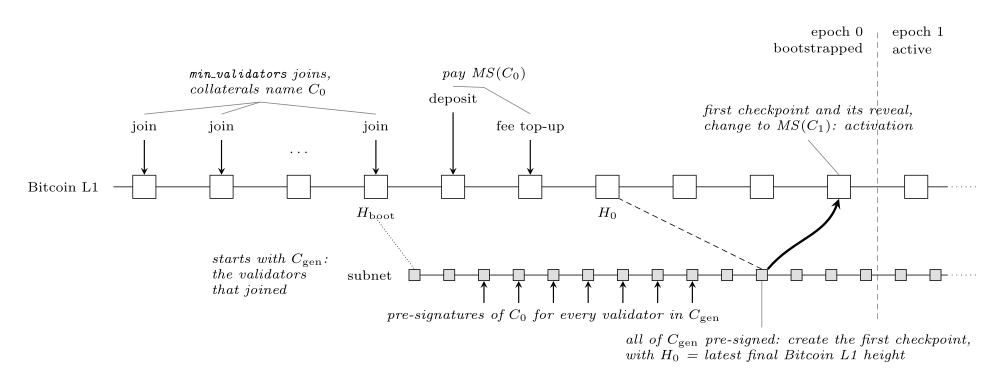

# Subnet lifecycle

This document follows a subnet from creation to end: who submits which transaction and when, how the monitor derives the configurations and status from Bitcoin L1, the state it keeps and how it processes blocks. The last section gives the conditions on the parameter values. Slashing, from the votes on the subnet to the slash transaction, is in [slashing.md](slashing.md). The transaction formats and the monitor's checks on each are in `transactions/`, the encodings and scripts in [encoding.md](encoding.md).

## Actors

- The **creator** chooses the subnet's parameters and submits the create subnet transaction.
- A **validator** holds a validator key, an x-only key with even Y. It joins with a collateral, runs a subnet node, signs checkpoints and slash transactions with its key, and exits after its collateral matures. It acts on Bitcoin L1 through its **provider**, which builds, signs and submits its transactions.
- A **user** deposits BTC into a subnet, transfers within and between subnets, and withdraws to Bitcoin L1.
- The **subnet** is the validators of its current configuration running the subnet's consensus. It produces subnet blocks, decides the content of each checkpoint and collects the validators' signatures.
- A **relayer** submits the checkpoint to Bitcoin L1 with the signatures the subnet collected.
- A **monitor** reads final Bitcoin L1 blocks and derives the state of every subnet from them alone. Every provider and every subnet node relies on a monitor. All honest monitors hold the same state.

## Parameters

### Network parameters

A Bitcoin L1 block is final once at least `CONFIRMATIONS` blocks are on top of it. A deployment sets `CONFIRMATIONS` once, for all its monitors.

The prefix of every subnet id names the Bitcoin L1 network:

| Network | Prefix |
|---|---|
| mainnet | `/b1` |
| testnet3 | `/b2` |
| testnet4 | `/b22` |
| signet | `/b3` |
| regtest | `/b4` |

### Protocol constants

| Name | Value | Meaning |
|---|---|---|
| `MIN_CONFIGURATION_SIZE` | 4 | the minimum number of validators of a configuration. A smaller configuration stalls the subnet |
| `MAX_TOTAL_POWER` | 2³¹ − 1 | the maximum total power of a configuration |

### Subnet parameters

The creator sets every subnet parameter in the [create subnet](transactions/create-subnet.md) transaction. No parameter changes afterwards.

| Name | Meaning |
|---|---|
| `min_validator_stake` | the minimum collateral of a join, in satoshis |
| `power_unit` | the number of satoshis per unit of power, `10^p` for an integer `p` with `0 ≤ p ≤ 15` ([power and thresholds](#power-and-thresholds)) |
| `min_validators` | the number of accepted joins that bootstraps the subnet. It also sets the threshold of `C_0` |
| `bottomup_check_period` | the number of subnet blocks between two checkpoints |
| `active_validators_limit` | the maximum number of validators of a configuration |
| `min_cross_msg_fee` | the minimum fee of a cross-subnet message, in satoshis |
| `whitelist` | the x-only keys that may join before activation |
| `K` | the length of an epoch, in Bitcoin L1 blocks |
| `min_timeout`, `max_timeout` | the minimum and maximum number of epochs for which a collateral seats its owner |
| `min_deposit` | the minimum value of a deposit or fee top-up that the monitor credits, in satoshis |
| `kill_vote_period` | the number of subnet blocks for which a kill proposal stays open |
| `kill_delay_period` | the number of epochs for which a subnet marked to be killed stays fully operational before its kill checkpoint |

[Instantiating the parameters](#instantiating-the-parameters), at the end of this document, gives the conditions on their values.

## Power and thresholds

A validator whose seating collaterals hold `S` satoshis in total has power `⌊S / power_unit⌋`. The remainder `S mod power_unit` adds no power. The same function gives the power on Bitcoin L1 (configuration multisigs) and on the subnet (the validator set). Every accepted collateral has power `≥ 1`, because it is `≥ min_validator_stake ≥ power_unit`. The monitor rejects a join or a stake whose collateral would bring the total power of the validators holding a collateral that counts (as in the validator limit of [join](transactions/join.md#verifying-the-transaction) rule 3) above `MAX_TOTAL_POWER`, so no configuration exceeds it. The subnet keeps each validator's total value and gives it the power `⌊total / power_unit⌋`.

A configuration of total power `P` has threshold `⌊2P / 3⌋ + 1`, except `C_0`, whose threshold is `⌊2 · min_validators / 3⌋ + 1` ([C_0](#computing-configuration-c_0)). A set of its validators can spend the configuration's multisig if and only if their powers sum to at least the threshold.

## Configurations

A configuration is a set of validators, each with a key and a power, with its own multisig address on Bitcoin L1 ([configuration multisig](encoding.md#configuration-multisig)). The code calls it a committee (`SubnetCommittee`). A subnet's configurations are `C_0` (the whitelist), `C_gen` (the genesis configuration), then `C_1`, `C_2`, …, where `C_e` is the configuration of epoch `e`. Each is defined below where the lifecycle reaches it. Two configurations with the same keys, powers and threshold have the same multisig and scripts, so a script that names one names both.

## Lifecycle

### Creating the subnet

The creator submits the [create subnet](transactions/create-subnet.md) transaction. The monitor checks the [validity of the parameters](#validity-of-the-parameters), derives the subnet id from the transaction and stores the subnet's genesis info. The subnet is now **created**.

### Computing configuration C_0

When it processes the create subnet transaction, the monitor computes `C_0`: the keys of `whitelist`, each with power 1, and threshold `⌊2 · min_validators / 3⌋ + 1`. Every whitelisted key counts toward the threshold, joined or not. `C_0` never changes. Any `⌊2 · min_validators / 3⌋ + 1` whitelisted keys can spend `MS(C_0)`, so its funds are safe only if fewer than that many whitelisted keys are not honest.

`MS(C_0)` receives every fund that arrives before activation: prefunds, deposits and fee top-ups. The collateral of every join before bootstrap names `C_0` in its slash leaf.

### Joins and prefunds before bootstrap

From creation until bootstrap, every validator with a whitelisted key may submit a [join](transactions/join.md), whose collateral names `C_0`. Users and validators may also submit [prefunds](transactions/prefund.md), which pay `MS(C_0)` and give an EVM address a genesis balance on the subnet. A validator needs a subnet account to broadcast its signatures, so it prefunds its own subnet address, or deposits to it after activation.

The monitor checks each join as [join](transactions/join.md#verifying-the-transaction) describes and adds each accepted prefund to the genesis balances. It accepts prefunds only before bootstrap, and joins only before bootstrap and after activation.

### Computing configuration C_gen

The subnet bootstraps at the accepted join that brings the number of accepted joins to `min_validators`. `H_boot` is the height of the block that contains it. When it processes that join, the monitor computes `C_gen`, the genesis configuration: the validators of the `min_validators` accepted joins, each with power 1. `C_gen` never changes. The subnet is now **bootstrapped**, and epoch 0 begins.

### Activation

Activation ends epoch 0. It happens when the monitor processes the reveal of the subnet's first checkpoint, which moves the funds from `C_0` to `C_1` and carries `H_0`, the latest final Bitcoin L1 height when the subnet creates it. Epochs count from `H_0`. The monitor then computes `C_1`, and the subnet becomes **active**. The [subnet status](#subnet-status) table lists every status.

### Epoch 0 and the first checkpoint

From `H_boot` on, the subnet produces blocks with `C_gen` as its validator set. Epoch 0 exists only to prepare activation:

1. For every member of `C_gen`, the validators of `C_0` sign the slash transaction of the member's collateral. The subnet collects these pre-signatures ([slashing](slashing.md#before-bootstrap-and-in-epoch-0)).
2. The subnet is inactive: it accepts no client operation and no state update. The monitor accepts no join. Users and validators may submit deposits and fee top-ups, which pay `MS(C_0)`. The subnet mints nothing in epoch 0.
3. Once the subnet holds the pre-signatures for every member of `C_gen`, it creates the [first checkpoint](transactions/checkpoint.md#the-first-checkpoint), which spends the funds of `C_0`. Its reveal carries the pre-signatures and `H_0`. The validators of `C_0` sign it through their providers, and a relayer submits it with its reveal.
4. If `C_1` would have fewer than `MIN_CONFIGURATION_SIZE` members, the subnet creates no first checkpoint and never activates.

*Bootstrap of a subnet, from the joins to activation: Bitcoin L1 blocks on top, subnet blocks below.*

### Computing configuration C_1

`C_1` holds the members of `C_gen` that satisfy both conditions:

1. The collateral of the member's join is unspent before the first checkpoint and [slashable](slashing.md#slashable-outputs): the first checkpoint carries pre-signatures of its slash transaction from members of `C_0` whose powers reach the threshold of `C_0`.
2. The collateral's timeout `T` satisfies `T > H_0 + 3K`.

Each member of `C_1` has the power of that collateral. A collateral of a stake in epoch 0 counts only from later cutoffs. The first checkpoint carries no refresh and no exit. `C_1` may be smaller than `C_gen` and than `min_validators`. `C_1` is the configuration of epoch 1 ([epochs](#epochs)).

### After activation

From activation until the subnet is killed or stalls:

- Validators submit [joins](transactions/join.md) whose collaterals name the current or the previous configuration. An accepted join seats its validator in the configurations computed at later cutoffs that it qualifies for ([C_e](#computing-configuration-c_e-for-e--2)). A validator that has joined adds a collateral, or renews a matured one, with a [stake](transactions/stake.md).
- Users submit [deposits](transactions/deposit.md) to the current configuration's multisig. Validators supply the fee reserve with fee top-ups. A deposit or incoming transfer to the previous configuration's multisig still counts if its block is at most `K/2` blocks after the cutoff that ends that configuration's epoch, or after `H_0` for `C_0` ([delayed arrivals](transactions/checkpoint.md#fund-utxos)).
- Every `bottomup_check_period` subnet blocks, the subnet creates a [checkpoint](transactions/checkpoint.md). Its validators' providers build and sign it, and a relayer submits it with its [batch transfer](transactions/batch-transfer.md). Checkpoints pay withdrawals and transfers, carry slash pre-signatures and refresh collaterals. The rotation checkpoint of each epoch moves the subnet's funds to the new configuration ([regular and rotation checkpoints](#regular-and-rotation-checkpoints)).
- A collateral stops seating its owner before it matures ([maturity](#maturity-of-a-collateral)). The owner spends it with the [exit](transactions/exit.md) transaction from block `T + 1` on, or leaves earlier with a [cooperative exit](#cooperative-exit).
- Anyone who learns the EOTS secret key of a validator that equivocated submits the [slash](transactions/slash.md) transaction of its collateral ([slashing](slashing.md)).
- Validators vote on the subnet to kill it. Once the votes reach the threshold, a checkpoint records the acceptance, and the subnet ends with its kill checkpoint ([the end of a subnet](#the-end-of-a-subnet)).

### Epochs

After activation, the cutoff heights `h_e = H_0 + e · K`, for `e ≥ 1`, divide the subnet's life into epochs of `K` Bitcoin L1 blocks. Epoch 1 begins at activation. When the monitor processes the cutoff block `h_e`, after its transactions, epoch `e` ends and epoch `e + 1` begins. Each epoch `e` has one configuration, `C_e`, which the monitor computes when the epoch begins. The configuration changes only at a cutoff, and the [rotation checkpoint](#regular-and-rotation-checkpoints) of epoch `e` moves the subnet's funds to `C_e`.

### Computing configuration C_e for e ≥ 2

When the monitor processes the cutoff block `h_e`, it computes `C_{e+1}`: every validator that holds, at that block, an unspent collateral that

1. is locked under the collateral script that names `C_e`,
2. has a timeout `T > h_{e+3}`, and
3. is [slashable](slashing.md#slashable-outputs) by the pre-signatures of checkpoints that the monitor has processed.

Each such validator has the [power](#power-and-thresholds) of the total value of those collaterals. If `C_{e+1}` has fewer than `MIN_CONFIGURATION_SIZE` members, the subnet stalls ([the end of a subnet](#the-end-of-a-subnet)).

From the cutoff on, `C_{e+1}` is the current configuration: new deposits and joins name it. The subnet's validator set becomes `C_{e+1}` at the rotation checkpoint of epoch `e + 1` ([configuration numbers](#adopting-a-new-configuration)). `C_e` then finalizes no further subnet block.

### Regular and rotation checkpoints

A checkpoint belongs to the epoch of the latest rotation checkpoint at or before it, and that epoch's configuration is the checkpoint's configuration ([rotation and regular checkpoints](transactions/checkpoint.md#rotation-and-regular-checkpoints)). Every checkpoint follows the same rule ([inputs](transactions/checkpoint.md#inputs)): it pays the earliest pending withdrawals and transfers that its inputs cover, carries slash pre-signatures, refreshes the collaterals whose owners signed a refresh, and spends fund UTXOs of the previous configuration and of its own. What it spends differs between the two kinds:

- The **rotation checkpoint** of epoch `e + 1` is the first checkpoint that the subnet creates after it learns the final cutoff block `h_e`. Its previous configuration `C_e` still holds all of the subnet's funds: the previous checkpoint's change and every deposit. The rotation checkpoint spends them and pays its change to `MS(C_{e+1})`, which moves the funds to the new configuration. Funds that do not fit move with the next checkpoints. It carries the configuration number of `C_{e+1}` ([configuration numbers](#adopting-a-new-configuration)) and is the first checkpoint that refreshes the collaterals locked under `C_e`. The first checkpoint is the rotation checkpoint of epoch 1, from `C_0` to `C_1`.
- A **regular checkpoint** is every other checkpoint. The previous checkpoint's change is already under its own configuration. From the previous configuration it spends only the funds that arrived late ([delayed arrivals](transactions/checkpoint.md#fund-utxos)) or did not fit in an earlier checkpoint. It refreshes the collaterals whose owners signed after the epoch's earlier checkpoints. It carries configuration number 0, except the subnet's second checkpoint, which carries that of `C_1` ([adopting a new configuration](#adopting-a-new-configuration)). It pays its change to the multisig of its own configuration.

**Assumption.** A block at height at most `h_{e+1}`, the cutoff that ends the epoch, includes the rotation checkpoint of epoch `e + 1`. The subnet's validators recreate it until a block includes it. If the monitor processes the cutoff block `h_{e+1}` before that checkpoint, the subnet stalls ([the end of a subnet](#the-end-of-a-subnet)). The same holds for the first checkpoint: if the monitor processes its reveal in a block above `h_1 = H_0 + K`, the subnet stalls instead of activating.

### Adopting a new configuration

The subnet adopts each new configuration in four steps:

1. **The monitor records the changes.** When it computes `C_{e+1}` at the cutoff `h_e`, the monitor records the changes from `C_e` to `C_{e+1}` (`StakeChangeRequest`), validator by validator in ascending order of their keys:
   - A validator that enters: a `Join` with its key, then a `Deposit` of the total value of its seating collaterals.
   - A validator that stays and whose total value changes: a `Deposit` or a `Withdraw` of the difference.
   - A validator that leaves: a `Withdraw` of its whole total value.

   The monitor numbers the changes 1, 2, 3, … per subnet, continuing from one configuration to the next. The **configuration number** of `C_0` and of `C_gen` is 0. That of `C_{e+1}` is the number of its last change, or that of `C_e` if there is no change.
2. **The subnet stores the changes.** Once the subnet's parent finality reaches the cutoff block `h_e`, the subnet reads the changes through its provider (`getstakechanges`) and stores them in its gateway (`storeValidatorChanges`).
3. **The rotation checkpoint applies them.** When the subnet creates its next checkpoint, it applies every stored change (`applyFinalityChanges`). The resulting power table becomes the subnet's validator set, and the checkpoint carries the configuration number of `C_{e+1}` as its `next_configuration_number`. A regular checkpoint applies no change and carries 0.
4. **The monitor checks the number.** When it processes the rotation checkpoint, the monitor checks its `next_configuration_number` ([verifying the checkpoint](transactions/checkpoint.md#verifying-the-transaction)).

**From `C_gen` to `C_1`.** The same steps take the subnet from `C_gen` to `C_1`, one checkpoint later, because the monitor computes `C_1` only when it processes the first checkpoint's reveal. At that block, the monitor records the changes from `C_gen` to `C_1` as in step 1, counting each member of `C_gen` with the value `power_unit`, which gives power 1. Once its parent finality reaches that block, the subnet stores the changes. Its next checkpoint, the subnet's second, applies them and carries the configuration number of `C_1`. Until then `C_gen` produces the subnet's blocks. The first checkpoint has already moved the funds to `MS(C_1)`, and every member of `C_1` is a member of `C_gen`. If the first checkpoint's reveal is in the cutoff block `h_1`, the second checkpoint is also the rotation checkpoint of epoch 2. It then applies the stored changes of both configurations and carries the configuration number of `C_2`.

### Collateral refresh

Every collateral moves once per epoch to the newest configuration, so that no seated validator's collateral stays locked under a configuration whose validators have exited:

- From the rotation checkpoint of epoch `e + 1` on, a checkpoint refreshes each collateral locked under `C_e`. It spends the collateral and recreates it with the same value, keys and timeout, and a slash leaf that names `C_{e+1}`. The refresh needs the owner's signature and the signatures of validators of `C_e` whose powers reach its threshold.
- The validators sign a refresh only for a collateral that matures after the end of epoch `e + 2`.
- A collateral that no checkpoint refreshes loses its seat in the next configuration, unless its script already names `C_{e+1}` because `C_{e+1}` and `C_e` have the same keys, powers and threshold.
- A validator of `C_e` signs the refreshes and the checkpoint inputs locked under `C_e` until the end of epoch `e + 1`, whether or not it holds a seat in `C_{e+1}`.

Reasoning on collateral refresh

The regular checkpoints of an epoch also refresh collaterals, for two reasons:

1. **Size.** With many validators, an epoch's refreshes do not fit in one standard transaction, because each refresh adds an input that carries the configuration's signatures.
2. **Owners sign after the cutoff.** The owner's signature covers the new collateral, which names `C_{e+1}`, so the owner can sign only after the cutoff `h_e`, once `C_{e+1}` is known. A later checkpoint of the epoch refreshes the collateral of an owner who signs after the subnet has built the rotation checkpoint.

### Cooperative exit

A validator leaves before its collateral matures with a cooperative exit: a checkpoint spends the collateral through its cooperative-exit leaf and pays its value to an unbonding output of the same keys ([unbonding script](encoding.md#unbonding-script)), whose slash leaf names the checkpoint's configuration.

- The owner may sign the exit of a collateral locked under the checkpoint's configuration or the previous one at any time. Any checkpoint, rotation or regular, carries the exits that owners have signed ([inputs](transactions/checkpoint.md#inputs)).
- The validators sign an exit only for a collateral that a refresh would also allow: one that matures after the end of the epoch after the checkpoint's epoch ([collateral refresh](#collateral-refresh)).
- The exited collateral no longer counts at later cutoffs, so its owner leaves the subnet at the next cutoff, unless another of its collaterals seats it. The unbonding output seats no one.
- The unbonding output stays slashable: the members of the checkpoint's configuration pre-sign its slash transaction, and the next checkpoint carries the pre-signatures. After the kill checkpoint, the validators keep them ([slashing](slashing.md#after-activation)).
- From `3K` blocks after the block that includes the unbonding output on, the owner spends it alone with the [exit](transactions/exit.md) transaction.

### Maturity of a collateral

A collateral with timeout `T` seats its owner in `C_{e+1}` only if `T > h_{e+3}` ([C_e](#computing-configuration-c_e-for-e--2)). Its owner therefore leaves the subnet at the first cutoff `h_e` with `T ≤ h_{e+3}`, unless another of its collaterals seats it. From block `T + 1` on, the owner spends the collateral with the [exit](transactions/exit.md) transaction.

### The end of a subnet

A subnet ends in one of two ways:

- **Kill.** A member of the subnet's validator set submits a kill proposal on the subnet, which counts as its vote. The other members vote on the subnet. At most one proposal is open at a time, and a validator votes once per proposal. The subnet counts the votes of the members of its current validator set with their current powers. It accepts the proposal if these reach the threshold of their configuration within `kill_vote_period` subnet blocks after the proposal. A proposal that expires closes, and a validator may then submit a new one. The next checkpoint records the acceptance with the flag bit `0x02` ([OP_RETURN data](transactions/checkpoint.md#op_return-data)). The monitor then marks the subnet **to be killed**. If that checkpoint belongs to epoch `e`, the subnet stays fully operational up to the end of epoch `e + kill_delay_period`: it creates checkpoints, rotates its configuration and accepts joins and stakes, and its users withdraw their funds. The rotation checkpoint of epoch `e + kill_delay_period + 1` is its [kill checkpoint](transactions/checkpoint.md#the-kill-checkpoint). It exits the collaterals whose owners have signed an exit, as many as it holds ([cooperative exit](#cooperative-exit)), and burns the rest of the subnet's funds. When the monitor processes it, it marks the subnet **killed**. From then on every other subnet rejects transfers to it. The owner of any other collateral spends it through the unilateral-exit leaf once it matures.
- **Stall.** The subnet is **stalled** when `C_1`, or a configuration that the monitor computes at a cutoff, has fewer than `MIN_CONFIGURATION_SIZE` members, when the monitor processes the cutoff block `h_{e+1}` before the rotation checkpoint of epoch `e + 1`, or when it processes the first checkpoint's reveal in a block above `h_1` ([regular and rotation checkpoints](#regular-and-rotation-checkpoints)).

Once a subnet is killed or stalled, the monitor accepts no further checkpoint, join or stake and computes no further configuration. It still processes the batch transfer of the kill checkpoint, and Bitcoin L1 keeps the exit and slash transactions open.

## Subnet status

| Status | From | Meaning |
|---|---|---|
| created | the create subnet transaction | parameters and `C_0` known. The monitor accepts joins and prefunds |
| bootstrapped | the join that completes `C_gen` (`H_boot`) | epoch 0: the subnet runs with `C_gen` and collects pre-signatures. No join, client operation or state update |
| active | the reveal of the first checkpoint (activation) | all operations, with the configurations `C_1`, `C_2`, … |
| to be killed | the checkpoint that records an accepted kill proposal | operations continue until the kill checkpoint |
| killed | the kill checkpoint | no further operation |
| stalled | a stall condition ([the end of a subnet](#the-end-of-a-subnet)) | no further checkpoint |

## State kept by the monitor

The monitor keeps the following state for every subnet. Names in parentheses are the code's.

- **Genesis info** (`SubnetGenesisInfo`), from the create subnet transaction on: the subnet id, the parameters, `C_0`, the accepted joins before bootstrap, `H_boot` (`genesis_block_height`) once known, and the genesis balance entries (address, amount, prefund txid, height) of the accepted prefunds.
- **Subnet state** (`SubnetState`), from bootstrap on: the current epoch `e`, the current configuration `C_e` (`committee`) and its configuration number, the number of the last checkpoint, the fee reserve ([fund UTXOs](transactions/checkpoint.md#fund-utxos)), the status, `H_0` once known, and the checkpoint number at which the monitor marked the subnet to be killed.
- **Configurations** (`committee::<subnet>:<n>`): the configuration of every epoch, by epoch.
- **Configuration changes** (`StakeChangeRequest`): for every configuration computed at a cutoff, its changes, each with its kind, validator key and subnet address, amount, configuration number and the cutoff block.
- **Checkpoints** (`SubnetCheckpoint`): checkpoint number, subnet block hash and height, Bitcoin height and txid, the batch transfer txid and height, the configuration whose multisig its change pays, `next_configuration_number`, and the flags.
- **Fund UTXOs**: for every configuration, the outputs locked under its multisig that the monitor accepted ([fund UTXOs](transactions/checkpoint.md#fund-utxos)).
- **Rootnet messages** (`RootnetMessage`): the top-down messages for the subnet, numbered by a per-subnet message nonce from 0: funds (deposits and incoming transfers), ERC20 registrations and ERC20 transfers, each with the Bitcoin block that produced it.
- **Validators**: for every accepted join, the validator key, its EOTS key, its backup address and its subnet address.
- **Collaterals** (`UeCollateral`):
  - For every accepted join and stake: the collateral outpoint, value, timeout `T`, validator key, backup address, the configuration that its script names, and the txid of the join or stake.
  - For every refresh and cooperative exit: the new collateral or unbonding output that the checkpoint creates, with the backup address of the collateral it replaces and, for an unbonding output, the height of its block.
  - For every output: its spend, once a block includes one.
- **Token balances**: for every ERC20 token (home subnet, home token address) and every subnet, the amount of that token the subnet holds.
- **Slash pre-signatures**: for every collateral and unbonding output, the pre-signatures of the entry that made it slashable ([slashable outputs](slashing.md#slashable-outputs)).
- **EOTS nonce commitments**: for every EOTS key, the [EOTS nonce commitments](encoding.md#eots-nonce-commitment) of its accepted join and stakes.
- The height of the last processed block.

The subnet state does not exist before bootstrap: a lookup of it returns "not found", and the genesis info answers lookups instead.

## Processing Bitcoin L1 blocks

- **Finality.** The monitor processes a block only once it is final, in height order without gaps. A reorganization deeper than `CONFIRMATIONS` blocks is outside this specification.
- **Order.** The monitor processes a block's transactions in block order. Within a transaction, it processes the messages in the input witnesses before the message in the outputs. After the transactions of a cutoff block, it computes the next configuration ([C_e](#computing-configuration-c_e-for-e--2)).
- **Atomicity.** The monitor applies a block as a whole or not at all: all of a block's state changes, the configuration computed at a cutoff included, and the new last processed height take effect together. If the monitor stops while it processes a block, it keeps none of that block's changes and resumes from the previous block's state. Processing the block again gives the same result, because the state depends only on the blocks before it.
- **Determinism.** The state depends only on the final Bitcoin L1 blocks and the parameters, so every honest monitor of a deployment holds the same state at the same height. The monitor ignores a message that breaks its rules and never applies part of one. It records every spend of a fund UTXO, a collateral or an unbonding output that it holds, whatever transaction spends it and whether its message is valid or not.
- **Bitcoin reads.** To check a join, the monitor reads the commit transaction that the join's reveal spends, which is in the same block or an earlier one.

## Instantiating the parameters

This section gives the conditions on the parameter values: those the monitor checks on the create subnet transaction, and those the creator and the validators must meet for the protocol to be safe and live.

### Validity of the parameters

When the monitor processes a create subnet transaction, it checks:

- `p ≤ 15`, `min_validator_stake ≥ power_unit`, `min_validators > 0`, `bottomup_check_period > 0`, `K > 0`, `min_cross_msg_fee > 0` and `kill_vote_period > 0`.
- The keys of `whitelist` are distinct, `min_validators ≤ |whitelist| ≤ 350` and `min_validators ≤ active_validators_limit ≤ 350`, so that every slash transaction stays within the 10,000 vB of TRUC ([slash](transactions/slash.md#transaction-format)).
- `min_validators ≤ 90`, so that the reveal of the first checkpoint holds the pre-signatures of every member of `C_gen` within the size of a standard transaction ([slashing](slashing.md#before-bootstrap-and-in-epoch-0)).
- `1 ≤ min_timeout ≤ max_timeout` and `3K ≤ 65535`, the largest relative timelock in blocks.
- `min_deposit ≥ 330`, the dust limit of the P2TR output that a deposit creates.

If a condition fails, the monitor ignores the transaction and creates no subnet.

A subnet with `min_validators < MIN_CONFIGURATION_SIZE` never activates, because `C_1` is a subset of the `min_validators` genesis validators.

### Assumptions

All bounds count Bitcoin L1 blocks.

- **Finality.** A block with at least `d` blocks on top of it stays in the chain of every honest party. Such a block and its transactions are final. `d = CONFIRMATIONS`.
- **Inclusion.** When an honest party submits a valid transaction that pays a sufficient fee, within `Δ_incl` blocks a block includes that transaction or another one that spends one of its inputs.
- **Signing.** The subnet signs and submits a checkpoint within `Δ_sign` blocks after the latest Bitcoin L1 block that the checkpoint takes into account is final. `Δ_sign` includes the wait for the previous checkpoint and the recreation of a checkpoint whose input another transaction spent.
- **Checkpoint period.** The subnet produces `bottomup_check_period` subnet blocks within `Δ_cpt` blocks.
- **Adoption.** A configuration stops finalizing subnet blocks within `Δ_adopt` blocks after the block at the cutoff that ends its epoch is final.
- **Observation.** Within `Δ_obs` blocks after a validator signs two conflicting subnet blocks, every honest validator observes it, and one of them submits the slash transaction of each unspent collateral and unbonding output of that validator. Within `Δ_obs` blocks after a block includes a transaction that creates a new collateral or unbonding output from them, one of them submits its slash transaction.
- **Checkpoints per epoch.** Within every epoch `e + 1`, blocks at heights at most `h_{e+1}` include the epoch's rotation checkpoint ([regular and rotation checkpoints](#regular-and-rotation-checkpoints)) and, except in the epoch of the kill checkpoint, later checkpoints with their batch transfers, which carry the pre-signatures of the collaterals and unbonding outputs that the rotation checkpoint created. The checkpoints of the epoch spend every fund UTXO of `C_e`, and the kill checkpoint every fund UTXO of the subnet, within the size of a standard transaction.
- **Honest validators.** In every configuration, the validators that are not honest hold less than 1/3 of the power. Slashing of equivocation needs only that they hold at most 2/3.

### Choosing the parameter values

The guarantees also depend on conditions that no monitor can check, because they relate the parameters to the bounds of the [assumptions](#assumptions), which no Bitcoin L1 block records. The creator must choose `K` and `bottomup_check_period`, and the validators must keep the fee reserve, so that these conditions hold:

- Anchoring, withdrawals and transfers are safe and live if `K/2 ≥ 2d + Δ_cpt + Δ_sign + Δ_incl` and the fee reserve pays the fees of every checkpoint and leaves a change output of at least `min_deposit`.
- Deposits are safe and live if `K/2 ≥ d + Δ_incl`, which the first condition implies.
- A validator that equivocates loses its collateral to the slash transaction if `K ≥ 2d + Δ_adopt + 2(Δ_obs + Δ_incl)`.
